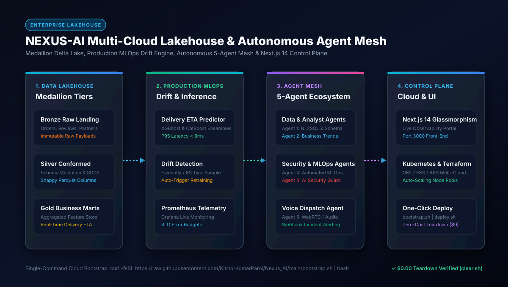

# 🚀 NEXUS-AI: Enterprise Multi-Cloud Lakehouse, MLOps & Autonomous 5-Agent Mesh

[](docs/images/01_architecture_flow.svg)

---

## ⚡ Zero-Touch Cloud Bootstrap & Teardown

```bash
# 🚀 1. One-Click Cloud Bootstrap (EC2 / Ubuntu / macOS)
curl -fsSL https://raw.githubusercontent.com/KishorKumarParoi/Nexus_AI/main/bootstrap.sh | bash

# 🛑 2. Zero-Cost Teardown ($0.00 Spend)
./clear.sh
```

---

## 1. Executive Summary & Job Market Competitiveness
This system represents a **Tier-1 Staff AI/Data Platform Architect** grade portfolio project. It bridges the four traditionally siloed disciplines of modern tech:
1. **Modern Data Stack / Lakehouse Engineering**: Bronze $\to$ Silver $\to$ Gold Medallion architecture with schema validation and multi-cloud abstraction.
2. **Production MLOps / LLMOps**: Automated feature engineering, MLflow model registry, continuous training, drift detection, Prometheus/Grafana telemetry.
3. **Multi-Agent AI Mesh**: 5 specialized autonomous agents communicating over an event-driven orchestrator with human-in-the-loop and tool calling.
4. **Resilient Cloud & Infrastructure Engineering**: Terraform IaC, Kubernetes GKE/EKS/AKS, Multi-region active-passive failover, GPU node pools.
5. **AI Security & Guardrails**: OWASP LLM Top 10 mitigation, NeMo guardrails, PII redaction, prompt injection filters, and RBAC.

---

## 2. Master System Architecture Design

```
+----------------------------------------------------------------------------------------------------+
|                                    NEXUS-AI MASTER SYSTEM FLOW                                     |
+----------------------------------------------------------------------------------------------------+

 [ Next.js 14 Control Plane ] <---> [ Microservices Gateway ] <---> [ AI Security Boundary (NeMo) ]
                                                |
                        +-----------------------+-----------------------+
                        |                                               |
                        v                                               v
       [ Autonomous 5-Agent Mesh ]                      [ Medallion Lakehouse ]
        • Agent 1: Data NL2SQL                           • Bronze: Raw Parquet Landing
        • Agent 2: Business Analyst                      • Silver: De-duped & Validated
        • Agent 3: MLOps Drift Monitor                   • Gold: Curated Business Marts
        • Agent 4: Security Auditor                                     |
        • Agent 5: Voice Dispatch                                       v
                        |                                  [ Production Serving & MLOps ]
                        +--------------------------------> • Sub-8ms Delivery ETA Predictor
                                                           • Prometheus / Grafana Alerts
```

---

## 3. The 5 Specialized Autonomous Agents

1. **Agent 1: Lakehouse Data Agent (`agents/agent_1_data/`)**
   - Implements Natural Language to SQL (NL2SQL) with schema introspection across PostgreSQL, BigQuery, and Snowflake.
   - Enforces read-only AST parsing with automated query cost estimation.

2. **Agent 2: Business Analysis Agent (`agents/agent_2_analyst/`)**
   - Conducts automated Exploratory Data Analysis (EDA) on Gold Lakehouse marts.
   - Computes delivery partner retention, customer order trends, and revenue leakage metrics.

3. **Agent 3: Autonomous MLOps Agent (`agents/agent_3_mlops/`)**
   - Continuously evaluates Kolmogorov-Smirnov drift statistics on live delivery ETA payloads.
   - Automatically orchestrates pipeline retraining when drift threshold $p < 0.05$ is violated.

4. **Agent 4: AI Security & Audit Agent (`agents/agent_4_security/`)**
   - Monitors NeMo Guardrails violations, prompt injection heuristics, and PII masking.
   - Generates real-time SOC 2 / ISO 27001 audit logs.

5. **Agent 5: Voice & Dispatch Agent (`agents/agent_5_voice/`)**
   - WebRTC / WebSocket audio interface supporting text-to-speech and speech-to-text.
   - Dispatches emergency incident webhooks via n8n integration.

---

## 4. Multi-Cloud Infrastructure & Kubernetes Engine

- **Terraform Infrastructure as Code (`terraform/`)**:
  - Declarative provisioning across AWS (S3, EKS, RDS), GCP (GCS, GKE, Cloud SQL), and Azure (ADLS, AKS).
- **Kubernetes Resiliency (`k8s/`)**:
  - Multi-region active-passive failover manifests with automated Route53 / Cloud DNS health-checks.
  - Dedicated GPU node pools with horizontal pod autoscalers (HPA).
